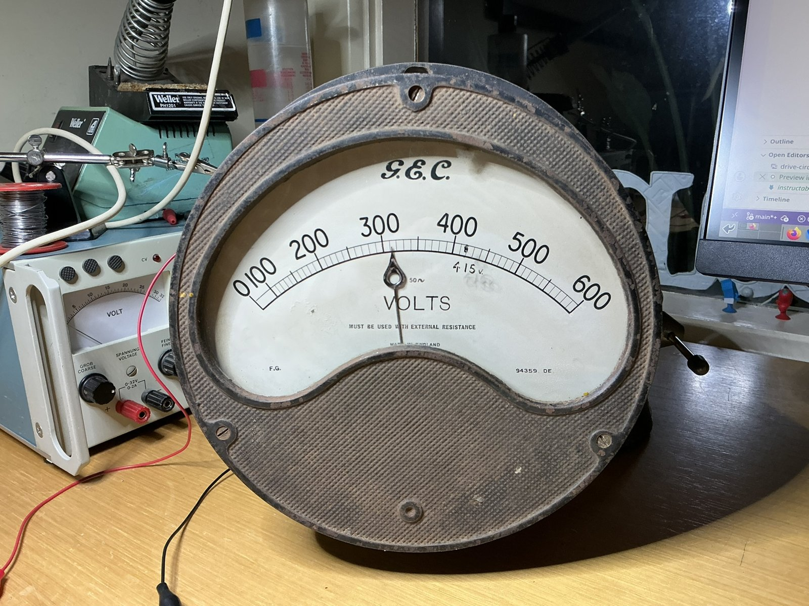
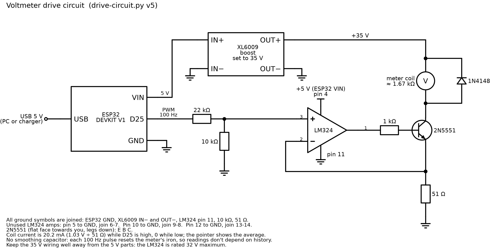

# Wireless Voltmeter


**An old G.E.C. switchboard voltmeter, driven over WiFi by an ESP32**

## What does it do?
It shows how much power our solar panels are making, on a switchboard voltmeter I picked up at a
garage sale. It listens to MQTT, so it can show anything you can get a number for. There's also a
demo mode that plays a pretend sunny day, clouds and all.

## How does it work?
An ESP32 running MicroPython subscribes to MQTT topics, adds up the numbers and moves the needle.
The old movement wants about 30 V for full scale, so a few cheap parts do the driving: an XL6009
boost module, an LM324 op-amp and a 2N5551 transistor hold the coil current steady, and 100 Hz
PWM from the ESP32 sets it. The whole story is on
[Instructables](https://www.instructables.com/Wireless-Voltmeter/).



## Files
- `pointer.py` moves the needle: the PWM, the calibration table and the glide. Recalibrate here.
- `meter.py` joins WiFi and MQTT and shows the number. Copy it to the board as `main.py`.
- `demo.py` demo mode, no WiFi needed.
- `SecretsExample.py` copy to `Secrets.py` and fill in your WiFi, broker and topics.

## Loading it
Flash MicroPython (ESP32_GENERIC) using the instructions on micropython.org, then:

```
mpremote cp pointer.py :pointer.py + cp Secrets.py :Secrets.py + cp meter.py :main.py + reset
```

To try the demo first, copy `pointer.py` and `demo.py`, then type `import demo` at the console.

## Parts
- An old analogue meter. Mine is a G.E.C. moving-iron switchboard voltmeter, 0–600 V AC.
- ESP32 dev board (DOIT DEVKIT V1)
- XL6009 boost converter module
- LM324N op-amp
- 2N5551 transistor
- Resistors: 51 Ω, 1 kΩ, 10 kΩ, 22 kΩ
- 1N4148 diode

## Build Instructions
https://www.instructables.com/Wireless-Voltmeter/

Code: MIT licence. Photos and schematic: CC BY-SA 4.0.

*More projects: https://makies.com.au*
